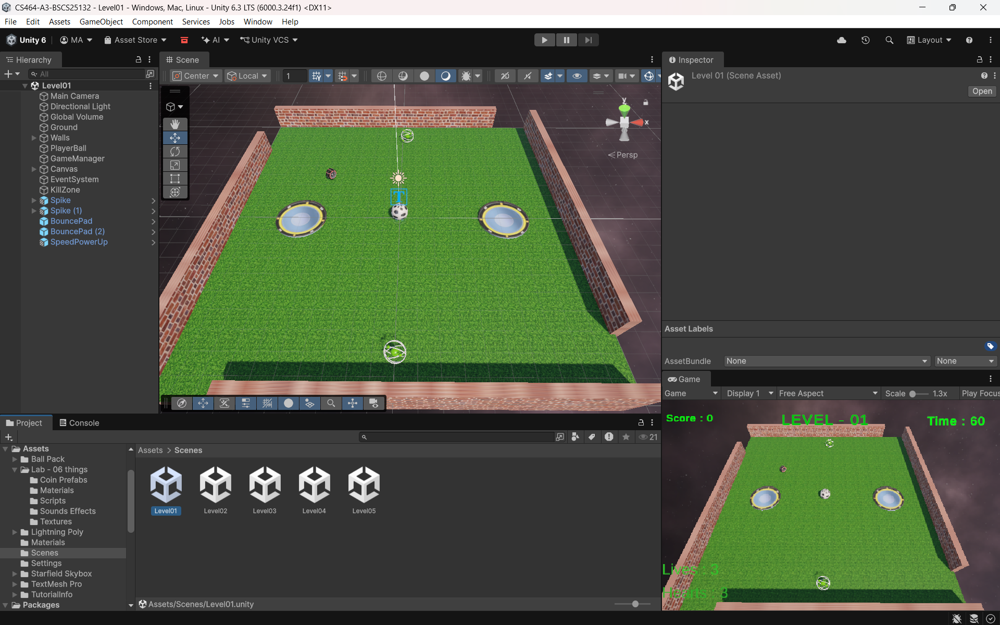
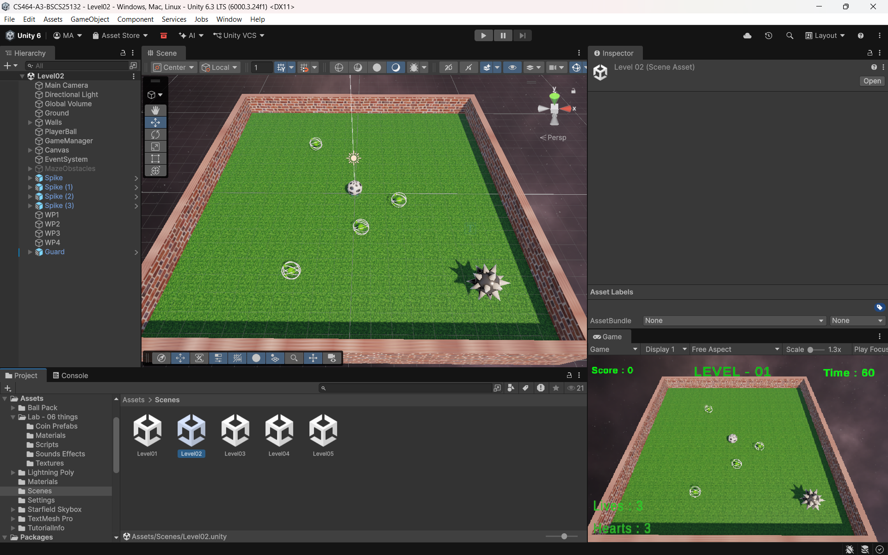
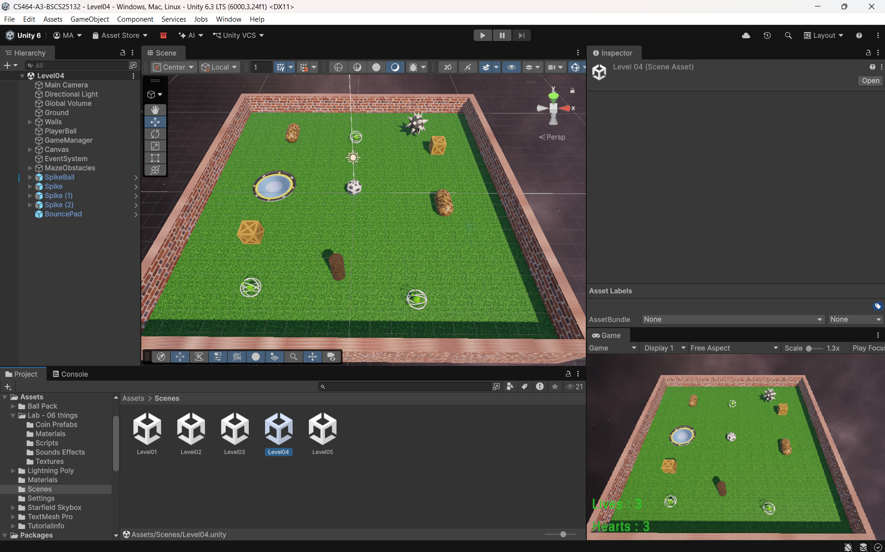
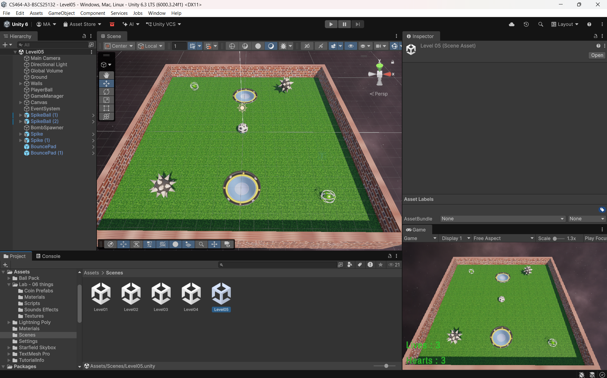

# CS464-A3-BSCS25132

# Coin Collector Ball Game (Assignment 03)

**Student Name:** Muhammad Abdullah (BSCS-25132)
**Course:** CS-464 Game Development, ITU | **Assignment:** 03

A 3D Unity game with 5 levels. You roll a ball, collect coins and stay away from dangers. I made this game from my Lab 06 game and added new things on top of it.

- **Started from:** My Lab 06 repo, because it already had 5 levels, coins, score and restart.
- **Controls:** W A S D to move the ball.
- **To win a level:** Collect all the coins before the timer ends.

## Levels

**Level 1: Easy Start**
Just collect the gold coins. No danger. This level is to learn the controls.

**Level 1**

**Level 2: Maze Run**
Obstacles are added, so the ball has to go around them. The timer is shorter.

**Level 2**

**Level 3: Bonus Coins**
A Red Coin appears once. When you take it, Blue Bonus Coins appear around you.

**Level 3**

**Level 4: Run!**
Enemy balls chase you. If one touches you, the game is over.

**Level 4**

**Level 5: Final Maze**
The hardest level. Fast enemies chase you and bombs appear in the maze. The timer is the shortest.

**Level 5**

## What I added in Assignment 03
- **Hearts:** You have 3 hearts. After a hit, you are safe for 1 second.
- **Lives:** If your hearts finish, you lose 1 life and start again from the beginning. If all lives finish, the game is over and you can Restart.
- **Spikes:** They take 1 heart and throw the ball back.
- **Guard:** It walks between points. If you come close, it chases you. If you run far, it stops and goes back to its path.
- **Bounce pad:** It throws the ball up.
- **Fall zone:** If the ball falls off the level, you lose a life.
- **Speed power-up:** It makes the ball faster for 5 seconds.

## The numbers

| Number | Value | Why |
|---|---|---|
| Patrol speed | 2 | Slow, so the player can see the guard's path. |
| Chase range | 4 | The guard only sees you when you are close. |
| Knockback | 15 (Impulse) | Throws the ball out of the danger clearly. |
| I-frames | 1 second | Enough time to run away from the danger. |
| Power-up time | 5 seconds | Long enough to cross the level. |

## Short answers

**1. Why does a trigger need a Rigidbody?**
Unity only sends the trigger message if a Rigidbody is in the pair. My ball has a Rigidbody, so coins, spikes and pads work when it touches them.

**2. Which ForceMode do you use and why?**
Knockback uses Impulse, because a hit is one quick push. The bounce pad uses VelocityChange, because it gives the same jump every time.

**3. What happens if a second power-up is picked while one is running?**
The old timer stops and a new 5 second timer starts. The boost does not stack.

**4. Why can `==` fail for arrival?**
A moving object almost never lands on the exact same number. So I check if the distance is very small instead.

## Links
- Gameplay Video Drive Link: https://drive.google.com/file/d/1UcgxbR5VPVhgwZjH2MNSuearDF0QsVDu/view?usp=sharing  
- Repo: https://github.com/MAbdullah-BSCS25132/CS464-A3-BSCS25132

## Made With
Unity, C#